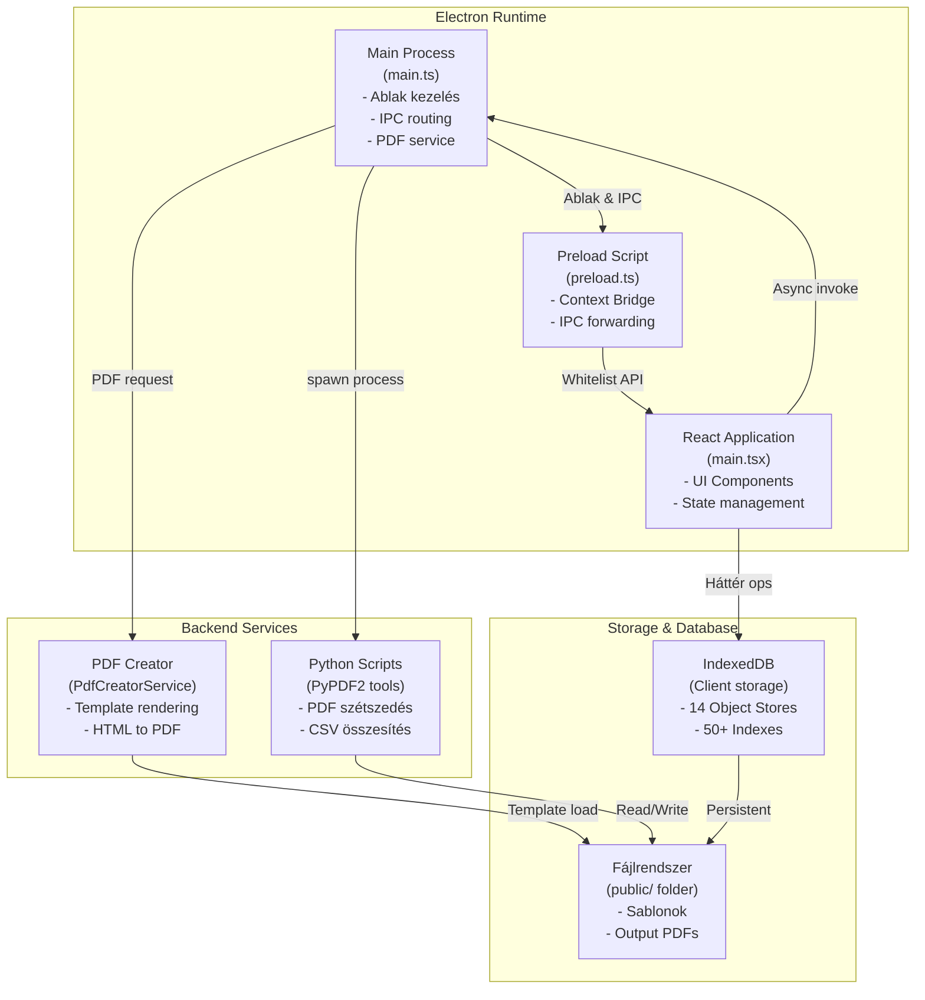
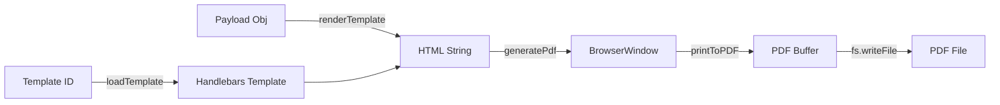

# Navigator Studio — Szakmai Gyakorlat Beszámoló

## Felhasználói felületi címsor

**Szakmai gyakorlat projektbeszámoló**

_Electron + TypeScript alapú alkalmazás architektúrája, adatfolyamai és implementációs döntései_

## 1. Bevezető

### 1.1 A projekt célja és kontextusa

A Navigator Studio egy modern Electron alapú asztali alkalmazás, amely a hazai gazdálkodó szervezetek (cégek, költségvetési szervezetek, nonprofit szervezetek, egyéni vállalkozók) administratív és dokumentációs feladatainak támogatására készült. Az alkalmazás összetett adatkezelési, PDF feldolgozási és automatizálási funkcionalitásokat integrál egy koherens felhasználói interfészbe, lehetővé téve a felhasználók számára, hogy hatékonyan kezeljék a vállalati adatokat és generáljanak szabályos dokumentumokat.

Az alkalmazás kifejlesztésének háttere abban rejlik, hogy a hazai szervezetek gyakran számos, heterogén formátumú dokumentummal kell foglalkozniuk: különféle szociális formátumok (ESZ, TSZ), munkaügyi formátumok (24M30, 25M30) és számos egyéb kormányzati nyomtatvány. Ezek manuális feldolgozása időigényes és hibára hajlamos. A Navigator Studio célja, hogy ezt az administratív terhet automatizáljon és a hibákat minimalizálja.

**A projekt fő célkitűzései:**

A **komplex adatmenedzsment** az alkalmazás központi funkciója. A vállalatok szervezeti hierarchiáját, tevékenységi köreit és kapcsolódó adatait hierarchikus struktúrában kell tárolni. Ez megköveteli egy olyan adatbázis-réteg kialakítását, amely támogatja a relációs kapcsolatokat (például egy vállalat több telephellyel, több képviselővel), és gyors keresést engedélyez. Az IndexedDB választása lehetővé teszi, hogy ezt az összetett adatstruktúrát az ügyfél oldalán tárolják, ezáltal offline működést és gyors hozzáférést biztosítanak.

A **dokumentumautomatizálás** szintén kritikus. Az alkalmazás Handlebars templating engine-t használ, amely lehetővé teszi, hogy HTML-alapú sablonokat dinamikus adatokkal feldöltsenek, majd ezeket PDF-formátumba konvertáljanak. Ez a megközelítés rugalmas és könnyen karbantartható, mivel új sablonok egyszerűen hozzáadhatók az alkalmazás frissítése nélkül.

A **folyamatautomatizálás** érdekében az alkalmazás Python-alapú feldolgozó scripteket integrál. A Python kiválasztása azért volt szükséges, mert a PyPDF2 és hasonló könyvtárak sokkal fejlettebb PDF manipulációs képességeket biztosítanak, mint amit az Electron/Node.js közvetlenül tudna. A Python scriptek IPC csatornákon keresztül kerülnek meghívásra, lehetővé téve a zökkenőmentes integrációt a felhasználói interfész és az adatbázis között.

### 1.2 Technikai stack és annak indoklása

Az alkalmazás fejlesztéséhez választott technológiák mindegyike konkrét üzleti és technikai igényekre adott válasz:

**Frontend technológiák**: A React 18.2.0 és TypeScript 5.2.2 kombinációja biztosítja a típusbiztonságot és a komponens-alapú felépítést, amely megkönnyíti az alkalmazás karbantartását és bővíthetőségét. A React Hook-ok lehetővé teszik a state management-et komponens szinten, míg a TypeScript típusok megakadályozzák a futásidejű típushibákat. A Material-UI (MUI) komponenskönyvtár kiválasztása fejlett, stilizált UI elemeket biztosít, amelyek a nyilvántartások és táblázatok megjelenítésére ideálisak.

**Desktop Runtime**: Az Electron 30.5.1 lehetővé teszi, hogy a webalkalmazás asztali alkalmazásként működjön Windows és macOS platformokon. Ez biztosítja, hogy az alkalmazás a felhasználó gépén futson, direkten hozzáférhet a fájlrendszerhez, és offline működésre képes. Az Electron választása alternatív asztali framework-kel (pl. Tauri) szemben abban rejlik, hogy már idő közben széles körben elismert és támogatott, valamint jól dokumentált.

**Build és fejlesztési eszközök**: A Vite 5.1.6 modern bundler, amely gyorsabb fejlesztési ciklust biztosít az hot reload funkciójával. Az Electron Builder szoftverek disztribúciójára specialista, amely automatizálja a Windows installer és macOS dmg fájlok generálását. Az npm package kezelő az aktuális Node.js ökoszisztéma szabványa.

**Adatbázis megoldás**: Az IndexedDB az egyetlen tartós kliens oldali tárolási lehetőség böngészőkben és Electron alkalmazásokban. Dokumentum-orientált adatbázisként (hasonlóan a MongoDB-hez) ideális az összetett, hierarchikus adatstruktúrák tárolására. Alternatívák (mint SQLite vagy egy szerver oldali adatbázis) nem voltak alkalmasak az offline működés és a gyors helyi hozzáférés igénye miatt.

**Backend scriptek**: A Python kiválasztása a PDF feldolgozásra azért történt, mert a PyPDF2 könyvtár robusztusan kezeli a PDF manipulációt, amit az Electron/Node.js közvetlenül nem tudna megtenni. A Python-Electron integráció az IPC csatornákon keresztül történik, amely tiszta szeparációt biztosít az üzleti logika és az interfész között.

### 1.3 Dokumentum hatóköre és szerkezete

Ez a szakmai gyakorlat beszámoló átfogó analízist nyújt a Navigator Studio architektúrájáról és implementációjáról. A dokumentum az alábbi fő területeket fedi le:

A **szoftver architektúra** szekció ismerteti az Electron multi-process modellt, amely az alkalmazás alapját képezi. Részletesen tárgyalja az IPC kommunikációs csatornákat, a biztonsági megfontolásékat és az adatfolyamot a különféle rétegek között.

Az **adatkezelés és adatbázis** rész a komplexrr IndexedDB sémát írja le, amely 14 Object Store-ot tartalmaz, és megmagyarázza az egyes store-ok szerepét az alkalmazás működésében. Ez a szekció részletesen tárgyalja az adatimport workflow-kat, az egyedi karakterkódolási kihívásokat és a deduplicálási stratégiákat.

A **komponensek és szolgáltatások** fejezet ismerteti az alkalmazás fő domain szeóvices-eit: a PDF Creator Service-t, az Import Service-t és az Employee Import Service-t. Ezek az alkalmazás üzleti logikájának magját képezik és mindegyiknek specifikus tervezési döntéseket igényelt.

Az **implementációs részletek** szekció a konkrét kódolási mintákra összpontosít: az IPC handler pattern-re, a PDF generálási workflow-ra és az IndexedDB tranzakciók kezelésére. Itt részletezik az olyan technikai megoldásokat, mint a karakterkódolás kezelése és a biztonsági izolálás.

Az **alkalmazottfejlesztés és teljesítmény** szekció azt tárgyalja, hogy miként lehet az alkalmazást optimalizálni a terhelés alatt. Kitér a batch operációkra, a rejtett PDF renderelésre és a parallel feldolgozásra.

A **kihívások és megoldások** fejezet konkrét problémákat és azok megoldásait ismerteti, amelyekkel az alkalmazás fejlesztése során szembesültünk. Ez tartalmazza a multithreading kihívásokat, a kódolási problémákat és a verziókezelési stratégiákat.

Végül, az **összefoglalás** szekció szintetizálja az elsajátított tanulságokat és javaslatot tesz a jövőbeli fejlesztésekre.

---

## 2. Rendszer Architektúra

### 2.1 Nagyvonalú felépítés és multi-process modell

A Navigator Studio az Electron framework multi-process modelljét használja, amely lehetővé teszi az alkalmazás hatékony és biztonságos működését. Az Electron alkalmazások két fő folyamatból állnak: a Main Process és a Renderer Process. Ennek az architektúrának az a célja, hogy elválassza az UI logikát az operációs rendszer szintű hozzáféréstől, így biztosítva a biztonságot és a stabilitást.

**A Main Process (Electron fő folyamat)** az alkalmazás szívverése. Ez a folyamat az operációs rendszer szintjén fut, és teljes hozzáféréssel rendelkezik az operációs rendszer API-jaihoz. Az alkalmazás életciklusa (indítás, bezárás), az ablakok kezelése, a fájlrendszer műveletek és a külső folyamatok (például a Python scriptek) elindítása mind a Main Process feladata. A Navigator Studio Main Process-ében az `electron/main.ts` fájlban vannak definiálva az alkalmazás indítása, az ablak létrehozása, az IPC csatornák és a PDF generálási szolgáltatás. Ez a megközelítés biztosítja, hogy az alkalmazás központi logikája konzisztens és könnyen karbantartható.

**A Renderer Process (felhasználói interfész)** az a folyamat, amely a felhasználóval közvetlenül interakcióba lép. Ez egy böngésző jellegű folyamat, amely React alkalmazást futtat. TypeScript típusosítás alatt a React komponensek és a Hook-ok felhasználói interakciókat kezelnek, állapotváltásokat kezelnek és az IndexedDB adatbázissal kommunikálnak. A böngésző-jellegű működés biztosítja, hogy az alkalmazás felhasználói interfész stabil marad, még ha a háttérben hosszú műveletek futnak.

**A Preload Script** (`preload.ts`) az a biztonsági réteg, amely a Main Process és a Renderer Process között helyezkedik el. Az Electron `contextIsolation` funkciója segítségével a Preload Script egy izolált kontextusban fut, amely nem rendelkezik direkten Node.js hozzáféréssel, de képes az IPC csatornákon keresztül kommunikálni. A Preload Script feladata, hogy csak azokat az API-kat exeponálja (teszi elérhetővé), amelyekre az alkalmazásnak szüksége van. Ez a megközelítés megakadályozza, hogy egy kompromittált webalkalmazás bármilyen mértékben hozzáférjen az operációs rendszert szintű funkcionalitáshoz.

**A Python Backend** az alkalmazás feldolgozó motorja. A Python scriptek (pdf_szetszedo, csv_joiner, automatikus_alairas) a Main Process által indított külső folyamatokként futnak. A Python választása azért volt indokolt, mert a PyPDF2 és hasonló könyvtárak robusztus PDF manipulációs képességeket biztosítanak. Az Electron/Node.js natív PDF manipulációja korlátozott lenne ehhez az igényhez. A Python scriptek outputja (stdout/stderr) az IPC csatornákon keresztül real-time streamelődik az UI-ba, biztosítva, hogy a felhasználó látja a feldolgozás előrehaladását.

Az alábbiakban egy mermaid diagram mutatja be az összes komponens közötti kapcsolatokat:



Ez az architektúra több szinten biztosítja a szeparáció, ami hozzájárul az alkalmazás stabilitásához, biztonságához és karbantarthatóságához.

### 2.2 IPC Kommunikációs csatornák — Részletes áttekintés

Az Inter-Process Communication (IPC) az Electron alkalmazások szíve: a Renderer Process és a Main Process között minden kommunikáció az IPC csatornákon keresztül történik. A Navigator Studio több, jól meghatározott IPC csatornát definiál, amelyek specifikus feladatokat végeznek.

Az IPC csatornák megvalósítása az `ipcMain.handle()` és az `ipcRenderer.invoke()` párosítást használja, amely promise-alapú, aszinkron interfészt biztosít. Ez lehetővé teszi, hogy az UI-nak ne kell blokkolt állapotban lennie a hosszú műveletek alatt.

**A `run-executable` csatorna** az alkalmazás legkritikusabb csatornája. Ennek a feladata, hogy az alkalmazás által szükséges Python scripteket elindítsa. Például, amikor a felhasználó egy PDF fájlt szét akar szedni, az UI ezt a csatornát hívja meg a megfelelő Python script-tel. A csatorna a Python scriptből érkező stdout és stderr outputot real-time streameli vissza az UI-ba, hogy a felhasználó nyomon követhesse a feldolgozás előrehaladását.

```typescript
ipcMain.handle("run-executable", (event, exeRelativePath: string, args: string[] = []) => {
  return new Promise((resolve, reject) => {
    const exePath = path.join(basePath, exeRelativePath);
    const child = spawn(exePath, args, { windowsHide: true });
    let stdout = "", stderr = "";
    
    // Stdout streamelés
    child.stdout?.on("data", (data: Buffer) => {
      const text = iconv.decode(data, "win1250");  // Windows-1250 → UTF-8
      event.sender.send("exe-stdout", text);
      stdout += text;
    });
    
    // Stderr streamelés
    child.stderr?.on("data", (data: Buffer) => {
      const text = iconv.decode(data, "win1250");
      event.sender.send("exe-stderr", text);
      stderr += text;
    });
    
    // Folyamat befejezése
    child.on("close", (code) => {
      code === 0 ? resolve(stdout) : reject(stderr);
    });
  });
});
```

Ez a megvalósítás több érdekes megoldást tartalmaz. Először is, a `spawn()` függvényt `{ windowsHide: true }` opcióval hívjuk, hogy az alapértelmezett parancssor ablak ne jelenjen meg. Másodszor, az `iconv` könyvtárat használjuk a Windows-1250 karakterkódolás UTF-8-ra konvertálásához, amely biztosítja, hogy a magyar karakterek (á, é, í, ó, ö, ő, ú, ü, ű) helyesen jelenjenek meg. Végül, az stdout és stderr egy promise-based szintaxison keresztül kezelődik, amely megkönnyíti az aszinkron error kezelést.

**A `pdf-create-schematic` csatorna** a PDF generálásért felelős. Ez a csatorna egy JavaScript objektumot kap (a PDF payload-ot), amely a Handlebars sablon összes szükséges adatát tartalmazza. A Main Process ezt átadja a PdfCreatorService-nek, amely HTML-t renderel és ezt PDF-vé konvertálja.

```typescript
ipcMain.handle("pdf-create-schematic", async (event, templateId: string, payload: any) => {
  const template = await PdfCreatorService.loadTemplate(templateId);
  const html = await PdfCreatorService.renderTemplate(template, payload);
  const outputPath = path.join(basePath, `output_${Date.now()}.pdf`);
  const result = await PdfCreatorService.generatePdf(html, outputPath);
  return { ...result, outputPath };
});
```

**A `get-public-path` csatorna** az alkalmazás által szükséges mapa útvonalait biztosítja. Ez azért szükséges, mert az útvonal fejlesztés alatt és az alkalmazás csomagolása után eltérő lehet:

```typescript
ipcMain.handle("get-public-path", (...segments: string[]) => {
  const basePath = app.isPackaged 
    ? path.join(process.resourcesPath, "public")
    : path.join(__dirname, "../../../public");
  return path.join(basePath, ...segments);
});
```

**Az ablak kezelési csatornák** (`minimize-window`, `maximize-window`, `close-window`) az alkalmazás ablakával végzendő operációkat biztosítják:

```typescript
ipcMain.handle("minimize-window", () => {
  BrowserWindow.getFocusedWindow()?.minimize();
});

ipcMain.handle("maximize-window", () => {
  const win = BrowserWindow.getFocusedWindow();
  win?.isMaximized() ? win.unmaximize() : win.maximize();
});

ipcMain.handle("close-window", () => {
  BrowserWindow.getFocusedWindow()?.close();
});
```

**Az `update-status` csatorna** az alkalmazás frissítési állapotáról informál. Az Electron auto-updater funkcija ezt a csatornát használja az UI-nak szignalizálásához, hogy frissítés érhető el vagy folyamatban van.

A Renderer Process oldalon ezek a csatornák a Preload Scripten keresztül érhetők el:

```typescript
contextBridge.exposeInMainWorld("api", {
  runExecutable: (exePath: string, args?: string[]) =>
    ipcRenderer.invoke("run-executable", exePath, args || []),
  createPdfSchematic: (templateId: string, payload: any) =>
    ipcRenderer.invoke("pdf-create-schematic", templateId, payload),
  getPublicPath: (...segments: string[]) =>
    ipcRenderer.invoke("get-public-path", ...segments),
});

ipcRenderer.on("exe-stdout", (_, data) => {
  // UI frissítés stdout adatokkal
});
```

### 2.3 Biztonsági megfontoláson és Context Isolation

Az Electron alkalmazások biztonsági kockázatai nagymértékben csökkenthetők a megfelelő architektúra-választásokkal. A Navigator Studio az Electron modern biztonsági best-practices-eit követi.

**Context Isolation** az alkalmazás biztonsági alapja. Ez azt jelenti, hogy a Renderer Process (amely a webalkalmazás futtatja) nem rendelkezik direkten Node.js API-khoz való hozzáféréssel. Ez megakadályozza, hogy egy kompromittált JavaScript kód direkt fájlrendszer műveletet végezne vagy más veszélyes operációt végezne:

```typescript
const mainWindow = new BrowserWindow({
  webPreferences: {
    preload: path.join(__dirname, 'preload.mjs'),
    contextIsolation: true,        // Rendszer és App kontextus elkülönítése
    nodeIntegration: false,        // Node.js API-k nem érhetők el közvetlenül
    sandbox: false,                // Szükséges fájl I/O-hoz (optional)
  },
});
```

A `nodeIntegration: false` beállítás biztosítja, hogy az alkalmazás-kód nem férhet hozzá a `require()` függvényhez vagy más Node.js globális objektumokhoz. A `contextIsolation: true` egész külön kontextusban futtatja a Preload Script-et, amely nem osztozik a Renderer Process memóriáján.

**Preload Script validáció** a második biztonsági réteg. A Preload Script expozíciós API-jain keresztül csak azokat a funkcionalitásokat tegyük elérhetővé, amelyekre az alkalmazásnak szüksége van. A Navigator Studio Preload Script-je szigorú whitelist alapú:

```typescript
// preload.ts
contextBridge.exposeInMainWorld("api", {
  // Csak szükséges IPC csatornák
  readFolder: async (relativePath: string) => {
    // Validáció: nem lehet ".." a path-ban
    if (relativePath.includes("..")) throw new Error("Invalid path");
    return ipcRenderer.invoke("read-folder", relativePath);
  },
  runExe: (exePath: string, args?: string[]) =>
    ipcRenderer.invoke("run-executable", exePath, args || []),
  // ... egyéb whitelisted API-k
});

// Explicit felsorolt event listener-ek
ipcRenderer.on("exe-stdout", (_, data) => {
  // Window event küldése az alkalmazásnak
  window.dispatchEvent(new CustomEvent("exe-stdout", { detail: data }));
});
```

A fájlrendszer hozzáférés még a Preload Script-ben is validálódik. Például, a `readFolder()` függvény nem engedi meg a relative path-ban a ".." szekvenciát, amely a `public/` könyvtáron kívúli fájlokhoz való hozzáférésre vezetne.

**Sandboxing**: A Navigator Studio `sandbox: false` beállítást használ (amit a fájlrendszer hozzáféréshez szükséges), de a Context Isolation még akkor is egyéb biztonsági réteget biztosít. Az alternatíva lenne a `sandbox: true`, de akkor az összes fájlrendszer operáció a Main Process-en kellene keresztülfutnia, ami teljesítményi okokból kevésbé ideális.

---

## 3. Adatbázis és Adatfolyam

### 3.1 IndexedDB séma — Teljes áttekintés

Az adatkezelés az alkalmazás kritikus komponense, és az IndexedDB séma megtervezése a teljes projektet alapvetően befolyásolja. A Navigator Studio az ügyfél oldali adatperszisztenciához az IndexedDB-t használja, amely egy böngésző- és Electron-alkalmazásokban elérhető, dokumentum-orientált adatbázis.

Az IndexedDB választása több okból volt indokolt. Először, lehetővé teszi offline működést: az alkalmazás működhet internet kapcsolat nélkül, mivel az összes szükséges adat a felhasználó gépén van tárolva. Másodszor, az objektum-orientált megközelítés (BSON-szerű) ideális a hierarchikus és relációs adatstruktúrák tárolásához. Harmadszor, az indexek gyors keresést biztosítanak, amit a felhasználók elvárnak. Végül, az Electron alkalmazásoknál az IndexedDB natívan elérhető, így nincs szükség további függőségekre.

A Navigator Studio adatbázis sémája 14 Object Store-ot tartalmaz, amely a hazai gazdasági adatbázisok összetett szerkezetét tükrözi. Minden Object Store egy logikai adatcsoport reprezentál:

| Object Store | Célja | Típusú |
|---|---|---|
| `CEGEK` | Vállalati alapadatok (cégnév, adószám, stb.) | Centrális |
| `TEAOR_KODOK` | TEÁOR tevékenységi kódok katalógusa | Referencia |
| `CEG_TEAOR_KAPCSOLATOK` | Vállalat-tevékenység reláció | Reláció |
| `GFO_KODOK` | Gazdálkodási forma kódok | Referencia |
| `CEG_GFO_KAPCSOLATOK` | Vállalat-forma reláció | Reláció |
| `CIMEK` | Székhelyek és telephelyek | Hierarchikus |
| `BANKSZAMLASZAMOK` | Bankszámlainformációk | Gyermek |
| `KEPVISELOK` | Jogi képviselők, ügyvédek | Gyermek |
| `TULAJDONOSOK` | Tulajdonosi szerkezet | Gyermek |
| `NYILATKOZATOK_ES_ADOZASI_ADATOK` | Adózási nyilatkozatok, áfa szám | Gyermek |
| `KAPCSOLATTARTASI_ADATOK` | E-mail, telefonszám, kontakt | Gyermek |
| `KORNYEZETVEDELMI_TERMEKDIJ_TETELEK` | Környezetvédelmi termékdíj | Speciális |
| `FORRASDOKUMENTUMOK` | Forrásadatok referenciája (melyik excel fájlból) | Meta |
| `MUNKAVALLALOK` | Alkalmazotti nyilvántartás | Centrális |

**A CEGEK store** az alkalmazás gerincét képezi. Minden vállalat egy dokumentumként van tárolva az alábbi szerkezettel:

```typescript
interface CegRecord {
  _id: string;                    // Primary key: cégazonosító
  _adoszama: string;              // Adószám (egyedi index)
  _cegnyilvantartasiSzama: string;    // Cégnyilvántartási szám
  _cegjegyzekAzonosito?: string;      // Cégjegyzék azonosító
  _vamazonositoSzama?: string;        // Vámazonosító
  _kozossegiAdoszama?: string;        // EU adószám
  _nev: string;                      // Cégnév
  _roviden_nev?: string;             // Rövidített név
  _alapitasIdejeNapja: Date;         // Alapítás dátuma
  _forrasFajlAzonosito: string;       // Melyik import fájlból származik
  _modositasIdeje: Date;             // Legutóbbi módosítás időpontja
  _torolve: boolean;                 // Logikai törlés jelző
}
```

A CEGEK store-nak 7 indexe van, amely lehetővé teszi a gyors keresést különféle kritériumok alapján:

```typescript
indexes: [
  { name: 'Adószáma', keyPath: '_adoszama', unique: true },
  { name: 'Cégnyilvántartási száma', keyPath: '_cegnyilvantartasiSzama', unique: true },
  { name: 'Vámazonosító száma', keyPath: '_vamazonositoSzama' },
  { name: 'Közösségi adószáma', keyPath: '_kozossegiAdoszama' },
  { name: 'ForrásFájlAzonosító', keyPath: '_forrasFajlAzonosito' },
  { name: 'MódosításIdeje', keyPath: '_modositasIdeje' }
]
```

Az egyedi indexek (unique) biztosítják az adat integritást: például adószám alapján csak egy cég lehet egy adott szám alatt. Az adószám index kritikus a kereséshez, mivel a felhasználók gyakran céget keresnek az adószámuk alapján. A `ForrásFájlAzonosító` index lehetővé teszi, hogy kövessük, mely importból származnak az adatok, ami hasznos az adatprovenance-hez. A `MódosításIdeje` index rendezésre használható az audit trail-hez.

**A CIMEK store** a cégen belüli hierarchikus szerkezetet kezeli. Egy vállalatnak több székhelye és telephelye lehet, amelyeket a CIMEK store-ban tárolunk:

```typescript
interface CimRecord {
  _id: string;                   // Primary key
  _cegAzonosito: string;         // Szülő cég referenciája (index)
  _cimTipus: 'Székhely' | 'Telephely';
  _iranyitoszam: string;         // Irányítószám
  _varos: string;                // Város
  _cim: string;                  // Utca, házszám
  _modositasIdeje: Date;
}
```

A CIMEK indexei `_cegAzonosito` alapján vannak szervezve, amely lehetővé teszi, hogy egy adott céget keressünk és annak összes címét lekérdezzük.

**A TEAOR_KODOK és GFO_KODOK store-ok** referencia katalógusok. Ezek a vállalatok tevékenységi körét és gazdálkodási formáját jelzik. Ezek fix adatok, amelyeket a hazai adatbázisokból import-áltak:

```typescript
interface TeaorRecord {
  _id: string;           // TEÁOR kód (pl. "01.11")
  _leiras: string;       // Tevékenység leírása
}
```

**A CEG_TEAOR_KAPCSOLATOK és CEG_GFO_KAPCSOLATOK store-ok** viszony-táblákat reprezentálnak. Egy cégnél több tevékenység és forma is lehet, ezért szükséges ez az n-m reláció:

```typescript
interface CegTeaorConnection {
  _id: string;
  _cegAzonosito: string;
  _teaorKod: string;
  _elsodleges: boolean;  // Fő tevékenység-e?
}
```

**Az ISKOLAZOTTSAGI_ADATOK és NYILATKOZATOK store-ok** a munkavállaló-specifikus adatokat tartalmazzák. Ezek hierarchikus gyermek-recordok, amelyek az `MUNKAVALLALOK` store-hoz kapcsolódnak.

**A hierarchikus adatstruktúra előnyei és hátrányai:**

Az IndexedDB normalizált struktúrát követi (hasonlóan a relációs adatbázisokhoz), amely biztosítja az adatintegritást és megakadályozza az anomáliákat. A normalizáció azonban azt jelenti, hogy bonyolult lekérdezésekhez több store-ot kell lekérdezni és az eredményeket az alkalmazás kódjában join-álni.

### 3.2 Indexek és keresési stratégia

Az Index-alapú keresés az alkalmazás teljesítményének kritikus tényezője. Az IndexedDB indexes-t biztosít az Object Store-okon, amely lehetővé teszi a gyors lekérdezéseket

 azok nélkül az összes dokumentumot végig kellene menni (full scan).

A keresési műveletek típusai:

**1. Egyedi keresés azonosító alapján:**
```typescript
async getById(cegAzonosito: string): Promise<CegRecord> {
  return new Promise((resolve, reject) => {
    const request = store.get(cegAzonosito);  // Primary key lookup
    request.onsuccess = () => resolve(request.result);
    request.onerror = () => reject(request.error);
  });
}
```
Ez az O(1) időben fut.

**2. Index-alapú keresés egyedi értékre:**
```typescript
async getByAdoszam(adoszam: string): Promise<CegRecord | undefined> {
  const index = objectStore.index('Adószáma');
  const request = index.get(adoszam);
  return new Promise((resolve, reject) => {
    request.onsuccess = () => resolve(request.result);
    request.onerror = () => reject(request.error);
  });
}
```

**3. Tartomány lekérdezés (range query):**
```typescript
async getByDateRange(startDate: Date, endDate: Date): Promise<CegRecord[]> {
  const index = objectStore.index('MódosításIdeje');
  const range = IDBKeyRange.bound(startDate, endDate);
  const request = index.getAll(range);
  return new Promise((resolve, reject) => {
    request.onsuccess = () => resolve(request.result);
    request.onerror = () => reject(request.error);
  });
}
```

Az összes lekérdezés aszinkron és promise-based, amely biztosítja, hogy a UI nem blokkolt.

### 3.3 Adatimport workflow — Részletes folyamat

Az adatimportálás az alkalmazás legbonyolultabb operációja. Ezt a folyamatot többdimenzionális tervező és fejlesztési erőfeszítések előzték meg, mivel az integritást biztosítani kell, miközben az összetett hierarchikus adatstruktúrát kell feldolgozni.

Az import workflow a felhasználó egy Excel fájl kiválasztásával indul. Az `import-service.ts` az alábbi lépéseket végzi:

**1. Fájl olvasás és XLSX parseálás:**

A Renderer Process az `xlsx` könyvtárat használja az Excel fájl memóriába olvasásához:

```typescript
const file = event.target.files[0];
const arrayBuffer = await file.arrayBuffer();
const workbook = XLSX.read(new Uint8Array(arrayBuffer), { type: 'array' });
const worksheet = workbook.Sheets[workbook.SheetNames[0]];
const data = XLSX.utils.sheet_to_json(worksheet);
```

**2. Struktúra felismerés és hierarchia szétszálazása:**

Az importált adatok gyakran hierarchikus struktúrát követnek: például egy cég alatt több telephely, amely alatt több képviselő van. Az import-service ezt a struktúrát szétszálazeaz és az megfelelő Object Store-okba helyezi:

```typescript
function processHierarchicalData(flatData: any[]): {
  ceges: CegRecord[],
  cimek: CimRecord[],
  kepviselok: KepviseloRecord[]
} {
  const companies = new Map();
  
  for (const row of flatData) {
    const companyId = row.cegAzonosito;
    if (!companies.has(companyId)) {
      companies.set(companyId, {
        ceg: parseCegRecord(row),
        cimek: [],
        kepviselok: []
      });
    }
    
    if (row.cimTipus) {
      companies.get(companyId).cimek.push(parseCimRecord(row));
    }
    if (row.kepviseloNev) {
      companies.get(companyId).kepviselok.push(parseKepviseloRecord(row));
    }
  }
  
  return Array.from(companies.values());
}
```

**3. Deduplikálás logika:**

Az alkalmazás `replace-company-children` stratégiát használ a deduplikáláshoz. Ez azt jelenti, hogy ha egy cég már létezik a databázisban, az új importált adatok helyettesítik a régit, beleértve az összes gyermek-rekordot. Ez a stratégia megakadályozza az adatok megduplázódását, de azt jelenti, hogy az import destruktív lehet.

```typescript
async replaceCompanyChildren(cegAzonosito: string, newData: CompanyData): Promise<void> {
  const transaction = db.transaction([
    'CEGEK', 'CIMEK', 'KEPVISELOK', 'TULAJDONOSOK'
  ], 'readwrite');
  
  // 1. Régi gyermekek törlése
  await deleteChildrenByCompany(transaction, cegAzonosito);
  
  // 2. Cég frissítése
  await transaction.objectStore('CEGEK').put(newData.ceg);
  
  // 3. Új gyermekek beszúrása
  for (const cim of newData.cimek) {
    await transaction.objectStore('CIMEK').add(cim);
  }
  for (const kepviselo of newData.kepviselok) {
    await transaction.objectStore('KEPVISELOK').add(kepviselo);
  }
  
  await transactionComplete(transaction);
}
```

**4. Batch Insert optimizálás:**

Az IndexedDB tranzakciók számos operációt tartalmazhatnak, de ezeket egészben kell feldolgozni. Az import-service batch-ekben dolgozik, hogy jó teljesítményt érjeljen el nagy adatmennyiségek importálásakor:

```typescript
async bulkInsert(records: any[]): Promise<void> {
  const batchSize = 1000;
  for (let i = 0; i < records.length; i += batchSize) {
    const batch = records.slice(i, i + batchSize);
    const transaction = db.transaction(['CEGEK'], 'readwrite');
    
    await Promise.all(batch.map(record =>
      new Promise((resolve, reject) => {
        const request = transaction.objectStore('CEGEK').add(record);
        request.onsuccess = () => resolve(undefined);
        request.onerror = () => reject(request.error);
      })
    ));
    
    await transactionComplete(transaction);
  }
}
```

Az import workflow a felhasználónak összefoglalást mutat az import után:
- Hány új céget adtak hozzá
- Hány céget frissítette
- Hány tétel volt hiba/kihagyott

### 3.4 Munkavállaló import (Employee CSV) — Speciális feldolgozás

A munkavállaló import egy speciális esete az adatimport-nak, mivel CSV formátumot használ Windows-1250 karakterkódolással. Ez az import type legfontosabb kihívása a karakterkódolás kezelése, de a CSV parseálás sem triviális.

Az Employee Import Service a `db/employee-import-service.ts` fájlban van implementálva:

```typescript
export class EmployeeImportService {
  async importFromCsv(
    cegAzonosito: string,
    csvBytes: Uint8Array,
    options?: EmployeeCsvImportOptions
  ): Promise<EmployeeCsvImportResult> {
    // 1. Karakterkódolás konverálása
    const csvText = this.decodeCsvBytes(csvBytes);
    
    // 2. CSV parseálás
    const rows = this.parseCsv(csvText);
    
    // 3. Fejléc normalizálása
    const normalizedRows = this.normalizeHeaders(rows);
    
    // 4. Munkavállaló objektumok létrehozása
    const employees = normalizedRows.map(row =>
      this.parseEmployeeRow(cegAzonosito, row)
    );
    
    // 5. Batch insert
    await this.bulkInsertEmployees(employees);
    
    return {
      success: true,
      importedCount: employees.length,
      errors: [],
    };
  }
  
  private decodeCsvBytes(bytes: Uint8Array): string {
    try {
      return new TextDecoder('windows-1250').decode(bytes);
    } catch {
      // Fallback UTF-8
      return new TextDecoder('utf-8').decode(bytes);
    }
  }
```

A karakterkódolás kezelés egy fallback stratégiát követik elsősorban Windows-1250 (CP1250), amely a magyar karaktereket támogatja, majd fallback UTF-8. Ez biztosítja a kompatibilitást mind az örökölt Windows fájlokkal, mind a modern UTF-8-alapú fájlokkal.

A CSV parseálás rugalmas: támogat szemikolon, tabulátor és vessző-elválasztókat:

```typescript
private parseCsv(text: string): string[][] {
  const lines = text.split(/\r?\n/);
  return lines
    .filter(line => line.trim().length > 0)
    .map(line => {
      // Próbálja meg szemikolonnal
      if (line.includes(';')) {
        return line.split(';').map(cell => cell.trim());
      }
      // Próbálja meg tabulátorral
      if (line.includes('\t')) {
        return line.split('\t').map(cell => cell.trim());
      }
      // Alapértelmezett: vesszővel
      return line.split(',').map(cell => cell.trim());
    });
}
```

A fejléc normalizálása a diakritikus eltávolítást is tartalmazza. Ez biztosítja, hogy a "Név" és "nev" oszlopok ugyanúgy kezelődnek:

```typescript
private normalizeHeaders(rows: string[][]): Record<string, string>[] {
  const headers = rows[0].map(h => this.normalizeHeader(h));
  return rows.slice(1).map(row => {
    const obj: Record<string, string> = {};
    headers.forEach((header, i) => {
      obj[header] = row[i] || '';
    });
    return obj;
  });
}

private normalizeHeader(header: string): string {
  return header
    .toLowerCase()
    .replace(/[áàâä]/g, 'a')
    .replace(/[éèêë]/g, 'e')
    .replace(/[íìîï]/g, 'i')
    .replace(/[óòôö]/g, 'o')
    .replace(/[úùûü]/g, 'u')
    .replace(/\s+/g, '_');
}
```

---

## 4. Komponensek és Szolgáltatások

### 4.1 Core domenszolgáltatások — Üzleti logika magja

Az alkalmazás üzleti logikájának magja a domain services-ekben van implementálva. Ezek az objektum-orientált service osztályok, amelyek jól meghatározott feladatokért felelősek. Ez a szeparáció a "Separation of Concerns" elv megvalósítása, amely megkönnyíti a kód karbantarthatóságát és tesztelésétől.

#### 4.1.1 PdfCreatorService — Dokumentumgenerálás

A PDF generálás az alkalmazás egyik legfontosabb funkcionalitása. A PdfCreatorService (`electron/services/PdfCreatorService.ts`) a Handlebars templating engine-t és az Electron `printToPDF()` API-ját kombinálva működik. Ez a megközelítés választása azért volt indokolt, mert az Handlebars lehetővé teszi összetett HTML sablonok definiálását, amelyekben logika (feltételek, ciklusok) is lehet, de az objektum-orientált, nem Turing-teljes, így biztonságos.

A PDF generálás workflow az alábbi lépésekből áll:

**1. Sablon betöltés:**

A sablonok HTML fájlok a `public/pdf_templates/` mappában, amelyek Handlebars szintaxist tartalmaznak. A sablon betöltés szinkron, mivel az alkalmazás indításakor gyorsítótárazza őket:

```typescript
static async loadTemplate(templateId: string): Promise<string> {
  const templatePath = path.join(basePath, 'pdf_templates', `${templateId}.html`);
  const template = await fs.promises.readFile(templatePath, 'utf-8');
  return template;
}
```

**2. HTML renderelés:**

A Handlebars kompilálás és az adatok (payload) behelyettesítése itt történik:

```typescript
static async renderTemplate(template: string, payload: any): Promise<string> {
  const compiled = Handlebars.compile(template);
  const html = compiled(payload);
  
  // Encoding biztosítás UTF-8-hoz
  return `<!DOCTYPE html>
    <html>
    <head><meta charset="UTF-8"></head>
    <body>${html}</body>
    </html>`;
}
```

**3. PDF konvertálás rejtett BrowserWindow-on keresztül:**

Az Electron `printToPDF()` API egy BrowserWindow objektumon keresztül működik. A PDF generáláshoz szükséges egy rejtett (invisible) ablak, amely az HTML-t rendereli, majd PDF-vé konvertálja:

```typescript
static async generatePdf(html: string, outputPath: string): 
  Promise<{ success: boolean; pageCount: number }> {
  const win = new BrowserWindow({ 
    show: false,
    webPreferences: {
      sandbox: true,  // PDF renderelés sandboxban
    }
  });
  
  await win.webContents.loadURL(`data:text/html;charset=utf-8,${encodeURIComponent(html)}`);
  
  // Várakozás a DOM rendelkezésre állására
  await win.webContents.executeJavaScript(
    'new Promise(resolve => window.addEventListener("load", resolve))'
  );
  
  const pdfData = await win.webContents.printToPDF({
    pageSize: 'A4',
    printBackground: true,
    margins: { top: 10, right: 10, bottom: 10, left: 10 },
  });
  
  await fs.promises.writeFile(outputPath, pdfData);
  win.destroy();  // Ablak felszabadítása
  
  // Oldal számlálás becsléssel
  const pageCount = Math.ceil(pdfData.length / 8000);  // Heurisztika
  return { success: true, pageCount };
}
```

A rejtett ablak rendkívül fontos a teljesítményhez: nem fog UI flicker-t okozni, és az alkalmazás nagy számú PDF-et generálhat párhuzamosan. Az `executeJavaScript` hívás biztosítja, hogy az oldal teljesen betöltött, mielőtt a PDF-et generálnánk.

**PDF sablonok az alkalmazásban:**

Az alkalmazás 5 fő PDF sablont tartalmaz, amelyek a hazai szociális és munkaügyi formákat képviselik:

| Sablon | Célja | Felhasználási eset |
|---|---|---|
| `esz-dontes.html` | Egyéni összevont statisztikai összeírás döntés | ESZ nyilvántartások |
| `esz-folyt.html` | ESZ folyamódosítás/módosítás | ESZ frissítések |
| `munkaszerzodes.html` | Munkaszerződés dokumentum | Alkalmazotti szerződések |
| `tsz-dontes.html` | Társas vállalkozás döntés | TSZ nyilvántartások |
| `jovedelemigazolas-mco.html` | Jövedeleming azolás MCO szervezetnél | Jövedelem igazolások |

Mindegyik sablon HTML5 formátumban van, amely biztosítja a zökkenőmentes nyomtatást és a konzisztens megjelenést.

#### 4.1.2 Import Service — Adatfeldolgozás és hierarchia kezelés

Az `import-service.ts` az XLSX (Excel) formátumú adatok komplex feldolgozásáért felelős. Ez az összeakalmazás legbonyolultabb szervize, mert a hierarchikus adatstruktúrát kell kezelni és normalizálni a flat Excel import adatokból.

Az Import Service fő feladatai:

**1. XLSX olvasás és szerializálás:**

Az `xlsx` (SheetJS) könyvtár segítségével az Excel fájlok olvashatók. Az alkalmazás támogat több sheet-et, és intelligensen felismeri, hogy melyik sheet tartalmazza az adatokat:

```typescript
async parseExcelFile(file: File): Promise<ParsedExcelData> {
  const arrayBuffer = await file.arrayBuffer();
  const workbook = XLSX.read(arrayBuffer, { type: 'array' });
  
  // Az első nem-üres sheet kiválasztása
  const worksheet = workbook.Sheets[workbook.SheetNames[0]];
  const data = XLSX.utils.sheet_to_json(worksheet, { defval: '' });
  
  return {
    fileName: file.name,
    recordCount: data.length,
    columns: Object.keys(data[0] || {}),
    data,
  };
}
```

**2. Hierarchikus struktúra szétszálazása:**

Az Excel adatok gyakran "flat" formátumban vannak, ahol egy sorban egy cég és annak egy telephelye van, de a cég többször előfordulhat más telephelyekkel. Az Import Service ezt a flat adatot hierarchikus struktúrára transzformálja:

```typescript
function unflattenHierarchy(flatData: any[]): CompanyHierarchy[] {
  const companies = new Map<string, CompanyHierarchy>();
  
  for (const row of flatData) {
    const companyId = row.cegAzonosito || row.adoszam;
    if (!companyId) continue;  // Skip üres sorokat
    
    if (!companies.has(companyId)) {
      companies.set(companyId, {
        ceg: parseCegRecord(row),
        cimek: [],
        kepviselok: [],
        tulajdonosok: [],
        bankszamlaszamok: [],
      });
    }
    
    const hierarchy = companies.get(companyId)!;
    
    // Gyermek-recordok hozzáadása
    if (row.cimTipus) hierarchy.cimek.push(parseCimRecord(row));
    if (row.kepviseloNev) hierarchy.kepviselok.push(parseKepviseloRecord(row));
    if (row.tulajdonosNev) hierarchy.tulajdonosok.push(parseTulajdonosRecord(row));
    if (row.bankszamlaszam) hierarchy.bankszamlaszamok.push(parseBankszamlaRecord(row));
  }
  
  return Array.from(companies.values());
}
```

**3. Deduplikálás stratégia - `replace-company-children`:**

Az import során a deduplikálás kritikus. Az alkalmazás jelenleg `replace-company-children` stratégiát használ, amely azt jelenti, hogy ha egy cég (adószám alapján) már létezik, az új import adatok helyettesítik a régit. Ez az aggresszív megközelítés biztosítja, hogy az adatok konzisztensek legyenek, de azt jelenti, hogy az import operáció nem csak hozzáad, hanem letörlött is:

```typescript
async importWithReplaceStrategy(hierarchy: CompanyHierarchy[]): Promise<ImportResult> {
  const transaction = db.transaction(
    ['CEGEK', 'CIMEK', 'KEPVISELOK', 'TULAJDONOSOK', 'BANKSZAMLASZAMOK'],
    'readwrite'
  );
  
  let createdCount = 0;
  let updatedCount = 0;
  
  for (const company of hierarchy) {
    const existing = await getCegById(company.ceg._id);
    
    if (existing) {
      // Régi gyermekek törlése
      await deleteChildrenByCompany(transaction, company.ceg._id);
      updatedCount++;
    } else {
      createdCount++;
    }
    
    // Cég szúrása/frissítése
    await transaction.objectStore('CEGEK').put(company.ceg);
    
    // Új gyermekek szúrása
    for (const cim of company.cimek) {
      await transaction.objectStore('CIMEK').add(cim);
    }
    // ... egyéb gyermek-recordok
  }
  
  await transactionComplete(transaction);
  
  return {
    success: true,
    createdCount,
    updatedCount,
    totalCount: hierarchy.length,
  };
}
```

**4. Batch Insert optimizálás:**

Nagyobb importok (több mint 10 000 cég) teljesítményi okok miatt batch-ekben kerülnek feldolgozásra. Az IndexedDB tranzakciók természetesen egy kömbként kezelődnek, de az alkalmazás 1000-es batch-et használ, hogy a felhasználói feedback azonnali maradjon:

```typescript
async bulkImport(companies: CompanyHierarchy[]): Promise<void> {
  const batchSize = 1000;
  
  for (let i = 0; i < companies.length; i += batchSize) {
    const batch = companies.slice(i, Math.min(i + batchSize, companies.length));
    
    const progressPercentage = Math.round((i / companies.length) * 100);
    this.emitProgress({ current: i, total: companies.length, percentage: progressPercentage });
    
    await this.importBatch(batch);
  }
}
```

#### 4.1.3 Employee Import Service — CSV feldolgozás

Az Employee Import Service szespecializált CSV feldolgozásra. A munkavállaló adatok gyakran különféle szervezeti rendszerekből exportálódnak CSV formátumban, és azok karakterkódolása gyakran Windows-1250.

**Funkciók:**

1. **Multi-encoding detekció:** Próbálja meg először Windows-1250-vel dekódolni, ha sikertelen, UTF-8-ra esik vissza
2. **Rugalmas CSV parseálás:** Támogat szemikolon, tabulátor és vesszőre elválasztott formátumokat
3. **Fejléc normalizálása:** A diakritikus eltávolít

ásával biztosítja, hogy "Név", "név", és "nev" ugyanúgy kezelödnek
4. **Adatvalidáció:** Row-by-row feldolgozás validálásssal

Az Employee Import Service implementációja már részletesen volt tárgyalva az adatbázis szekció 3.4-ben.

#### 4.1.4 Repository Pattern — Data Access Layer

A Repository pattern a Data Access Layer (DAL) absztrakciót biztosítja. Ahelyett, hogy a komponensek direkten az IndexedDB API-t használnák, egy repository objektumon keresztül érnek hozzá az adatokhoz. Ez több előnyt biztosít:

```typescript
export const cegekRepository = {
  // Create
  add: (record: CegRecord): Promise<string> =>
    table.cegek.add(record),
  
  // Read
  getById: (cegAzonosito: string): Promise<CegRecord | undefined> =>
    table.cegek.get(cegAzonosito),
  
  getByAdoszam: (adoszam: string): Promise<CegRecord | undefined> =>
    table.cegek.getFirstByIndex('Adószáma', adoszam),
  
  listAll: (): Promise<CegRecord[]> =>
    table.cegek.toArray(),
  
  // Update
  put: (record: CegRecord): Promise<string> =>
    table.cegek.put(record),
  
  // Delete
  delete: (cegAzonosito: string): Promise<void> =>
    table.cegek.delete(cegAzonosito),
  
  // Batch operations
  bulkAdd: (records: CegRecord[]): Promise<string[]> =>
    table.cegek.bulkAdd(records),
  
  bulkPut: (records: CegRecord[]): Promise<void> =>
    table.cegek.bulkPut(records),
};
```

**A Repository pattern előnyei:**

1. **Abstrakció:** Az IndexedDB implementációs részletei el vannak zárva. Ha majd át kellene térni egy másik adatbázisra, csak a repository-t kellene megváltoztatni.

2. **Unit testing:** A repository mock-olható, így az alkalmazás logikáját az adatbázis nélkül is lehet tesztelni.

3. **Type-safe interfészek:** TypeScript a repository típusa alapján type-checkingot végez, megakadályozva a futási idejű hibákat.

4. **Konzisztens query interface:** Az összes adatbázis lekérdezés ugyanúgy nézz ki, függetlenül az objektum típusától.

### 4.2 UI Komponensek és Screen-ek

A felhasználói felület a projekt egyik legfontosabb szervezőelve. Az alkalmazás UI-ja nem egyetlen, monolitikus képernyőként épül fel, hanem jól elkülönített vizuális és funkcionális rétegekre tagolódik. Ennek a döntésnek az volt a célja, hogy a komplex funkciók ellenére a felhasználó mindig világosan lássa, hol helyezkedik el az alkalmazásban, és az egyes munkafolyamatok között ne kelljen rejtett navigációs logikát követnie.

Az első szintet a globális alkalmazáskeret jelenti. A `AppHeader` komponens biztosítja az egyedi címsort, a logót és az ablakvezérlő gombokat, míg a `ViewSelector` szolgál a fő belépési pontként, ahol a felhasználó modulok között választhat. A `ScreenContainer` ezután tab-alapú munkateret hoz létre, ahol az egyes funkciók párhuzamosan is megnyithatók. Ez az elrendezés szándékosan az asztali alkalmazások megszokott működését követi: a felhasználó nem „oldalak” között bolyong, hanem munkafelületeket nyit meg és zár be.

A képernyőréteg a `src/screens/` mappában található, és funkcionális domének szerint tagolódik. Az egyes képernyők külön felelősséget kapnak: az adatbázis kezelés, a PDF generálás, a CSV összesítés, a digitális aláírás és a PDF szétszedés mind külön modulként jelenik meg. Ez a felosztás azért fontos, mert a különböző feladatok eltérő interakciós mintát igényelnek: egy adatbázis-listázó képernyő táblázatokra és szűrésre épít, míg egy dokumentumgeneráló képernyő inkább űrlapokra, fájlválasztókra és állapotjelzésekre.

```
src/screens/
├── HomeScreen.tsx
├── DatabaseManagerScreen.tsx
├── DatabaseViewerScreen.tsx
├── pdf_generator/
│   ├── EszDontesScreen.tsx
│   ├── EszFolytScreen.tsx
│   ├── JovedelemIgazolasScreen.tsx
│   ├── MunkaszerzodesCreatorScreen.tsx
│   ├── TszDontesScreen.tsx
│   └── TszFolytScreen.tsx
├── csv_joiner/
├── automatic_signer/
└── pdf_splitter/
```

Az egyik legfontosabb design döntés a tab-alapú munkatér bevezetése volt. A `tabManager` lehetővé teszi, hogy a felhasználó több képernyőt is megnyisson anélkül, hogy elveszítené az aktuális állapotát. Például egy cégadatbázis nézet és egy PDF generáló képernyő párhuzamosan is nyitva lehet. Ez jelentősen javítja az operatív munkát, mert a felhasználónak nem kell minden művelet után visszalépnie a főmenübe.

```typescript
tabManager.addTab({
  label: "Adatbázis nézet",
  component: DatabaseViewerScreen,
  props: {}
});
```

A `ScreenContainer` komponens ezt a modellt valósítja meg. Felül megjeleníti a nyitott tabokat, alatta pedig a kiválasztott képernyőt rendereli. A megoldás előnye, hogy a tablista mindig megőrzi a felhasználó mentális modelljét: látható, milyen modulok aktívak, melyik az aktuális munkaterület, és egy kattintással vissza lehet térni egy korábbi állapotra.

```typescript
export function ScreenContainer({ tabs }: ScreenContainerProps) {
  const [activeTab, setActiveTab] = useState<Tab | null>(null);

  useEffect(() => {
    const handleActiveTabChange = () => {
      setActiveTab(tabManager.getActiveTab() || null);
    };
    tabManager.on("activeTabChange", handleActiveTabChange);
    return () => tabManager.off("activeTabChange", handleActiveTabChange);
  }, []);
}
```

A vizuális kialakításnál a projekt tudatosan egyszerre törekszik funkcionalitásra és egyedi karakterre. A bal oldali nézetválasztó keskeny, függőleges sávként jelenik meg, amely kártyákba rendezve csoportosítja a fő funkciókat. Ez a döntés helyet takarít meg, és egyértelmű kategóriákba rendezi a bonyolult funkcionalitást. A kártyás szerkezet különösen hasznos az olyan alkalmazásnál, ahol sok egymástól független munkafolyamat van, mert a felhasználó vizuálisan is szervezett menürendszert kap.

```typescript
<ViewCard icon={ConstructionIcon} programLabelProps={[...]} />
<ViewCard icon={StorageIcon} programLabelProps={[...]} />
<ViewCard icon={PictureAsPdfIcon} programLabelProps={[...]} />
```

A `AppHeader` komponens az asztali alkalmazás-érzetet erősíti. A saját címsor és az egyedi ablakvezérlő gombok azt szolgálják, hogy az alkalmazás ne tűnjön böngészőnek, hanem natív munkaeszköznek. A fejléc drag régióként működik, a gombok pedig no-drag zónában helyezkednek el; ez a Windows-os és Electron-specifikus UX elvárásokhoz jól illeszkedik. Az ablakvezérlők szándékosan egyszerűek, mert a fő cél itt nem a látványos animáció, hanem a megbízható működés.

```typescript
<TitlebarButton onClick={() => window.api.minimize()}>
  <MinimizeIcon />
</TitlebarButton>
<TitlebarButton id="close-button" onClick={() => window.api.close()}>
  <CloseIcon />
</TitlebarButton>
```

A stílusrendszer alapvetően CSS fájlokra és változókra épül. Ez a megoldás praktikus, mert az alkalmazásnak több, egymástól eltérő vizuális zónája van: fejléc, navigációs sáv, tablista és fő munkaterület. A változókkal kezelt színrendszer előnye, hogy a sötét mód és az alkalmazás témája következetesen módosítható. A `ViewSelector` például állandó bal oldali sávként jelenik meg, míg a `ScreenContainer` a teljes rendelkezésre álló helyet kitölti, így a munkaterület mindig a funkcióhoz igazodik.

Ennek a UI-architektúrának fontos tervezési következménye, hogy a képernyők egymástól erősen izoláltak. Egy PDF-generáló képernyő nem ismeri a CSV-kezelő képernyő belső állapotát, és fordítva; az összekapcsolást a tabkezelő és az IPC réteg biztosítja. Ez a szeparáció csökkenti a komponensek közötti függőséget, és lehetővé teszi, hogy a képernyők önállóan fejlődjenek. Emellett a React Hook-alapú állapotkezelés egyszerűbbé teszi az életciklus-kezelést, például a fájlbetöltési, adatlekérési és betöltési indikátorok kezelését.

A UI megoldás összességében azt a célt szolgálja, hogy egy komplex, sokmodulos alkalmazás mégis gyorsan áttekinthető maradjon. A felhasználó a felső sávból az alkalmazás identitását, a bal oldali nézetválasztóból a funkcionális területeket, a tabokból pedig az aktuális munkafolyamatokat olvassa ki. Ez a háromszintű felépítés egyensúlyt teremt az információsűrűség és a használhatóság között, ami különösen fontos olyan környezetben, ahol a napi munka során több különböző üzleti folyamatot kell párhuzamosan kezelni.

### 4.3 Python Backend Scriptek — Speciális feldolgozás

A Python scriptek az alkalmazás feldolgozó motorja. Ezek PyInstaller-rel összefordított (.exe) futtatható fájlok, amelyeket az Electron Main Process IPC csatornákon keresztül indít el.

#### 4.3.1 PDF Szétszedés (pdf_szetszedo_*.py)

A PDF szétszedésnek számos formátuma van, mivel a hazai szervezeti formanyomtatványok különféle szerkezetűek. Az alkalmazás specifikus szétszedő scripteket tartalmaz minden támogatott formátumhoz:

```python
# pdf_szetszedo_24M30.py
import PyPDF2
import re
from pathlib import Path

def extract_24m30_data(input_file):
    reader = PyPDF2.PdfReader(input_file)
    
    results = []
    for page_num, page in enumerate(reader.pages):
        text = page.extract_text()
        lines = text.split('\n')
        
        # A 24M30 formátumban a név és cég fix helyen van
        try:
            name = lines[9].strip()
            company = lines[5].strip()
            
            results.append({
                'page': page_num + 1,
                'name': name,
                'company': company,
                'raw_text': text,
            })
        except IndexError:
            results.append({
                'page': page_num + 1,
                'error': 'Could not parse',
            })
    
    return results
```

**Támogatott formátumok:**

- **23M30, 24M30, 25M30:** Munkaügyi formátumok (szociális bejelentések)
- **BER:** Szociális bejelentés (közalkalmazott)
- **EFO:** Egyéni falvak és községek
- **EKHO:** Egyházi közalkalmazottak
- **JAR:** Járulékadó bevallás

Mindegyik formátumnak saját szétszedési logikája van, mivel az adatok helye eltérő az oldalon.

#### 4.3.2 CSV Összesítés (csv_joiner.py)

A CSV joiner több CSV fájlt kombinál eggyé. Ez hasznos, ha több adatforrásból kell egyesíteni az adatokat:

```python
import csv
from pathlib import Path

def join_csv_files(input_dir, output_file):
    files = sorted(Path(input_dir).glob('*.csv'))
    
    if not files:
        print("Hiba: Nincs CSV fájl az input mappában")
        return
    
    all_rows = []
    headers = None
    
    for file in files:
        with open(file, 'r', encoding='windows-1250') as f:
            reader = csv.DictReader(f)
            
            if headers is None:
                headers = reader.fieldnames
            
            for row in reader:
                all_rows.append(row)
    
    with open(output_file, 'w', encoding='windows-1250', newline='') as f:
        writer = csv.DictWriter(f, fieldnames=headers)
        writer.writeheader()
        writer.writerows(all_rows)
    
    print(f"Sikeres: {len(all_rows)} sorral összesen")
```

#### 4.3.3 Automatikus Aláírás (automatikus_alairas.py)

Az aláírási script (nyilvános API integrációval) digitális aláírást alkalmaz dokumentumokra. Ez egy harmadik fél API-járakosztható, amely az elektronikus aláírást kezeli.

### 4.4 Managers — Segédszolgáltatások

#### 4.4.1 FSManager (Fájlrendszer kezelő)

Az FSManager a fájlrendszer eseményeit kezeli. Az alkalmazás bizonyos mapákra figyel (pl. `public/pdf_szetszedo/in`), és amikor új fájlokat hoz létre a felhasználó, az alkalmazás automatikusan feldolgozhatja azokat:

```typescript
export class FSManager extends EventEmitter {
  private watchers: Map<string, fs.FSWatcher> = new Map();
  
  watchFolder(folderPath: string, callback: (file: string) => void): void {
    const watcher = fs.watch(folderPath, (eventType, filename) => {
      if (eventType === 'change' || eventType === 'rename') {
        callback(filename);
      }
    });
    
    this.watchers.set(folderPath, watcher);
  }
  
  unwatchFolder(folderPath: string): void {
    this.watchers.get(folderPath)?.close();
    this.watchers.delete(folderPath);
  }
}
```

#### 4.4.2 STDIOManager (Kimenet kezelő)

Az STDIOManager a Python scriptek stdout és stderr kimenetét vezérli:

```typescript
export class STDIOManager extends EventEmitter {
  handleStdout(data: Buffer): void {
    const text = iconv.decode(data, 'win1250');  // Karakterkódolás konverálás
    this.emit('data', { type: 'stdout', text });
  }
  
  handleStderr(data: Buffer): void {
    const text = iconv.decode(data, 'win1250');
    this.emit('data', { type: 'stderr', text });
  }
}

### 4.2 UI Komponensek és Screenek

Az alkalmazás modularizált képernyő-alapú struktúrát követ:

```
src/screens/
├── HomeScreen.tsx         // Fő navigációs hub
├── DatabaseManagerScreen.tsx   // Adatbázis kezelés
├── DatabaseViewerScreen.tsx    // Adatbázis megtekintés
├── pdf_generator/         // PDF szerkesztés modul
├── csv_joiner/           // CSV feldolgozás modul
├── automatic_signer/      // Digitális aláírás modul
└── pdf_splitter/         // PDF szétszedés modul
```

**Komponens felépítés:**
- Material-UI (MUI) alapú komponensek (Button, Dialog, Table, TextField)
- Emotion CSS-in-JS kezelés
- Hook-alapú state management (React useState, useEffect)

### 4.3 Python Backend Scriptek

#### 4.3.1 PDF Szétszedés

A `pdf_szetszedo_*` scriptek specifikus PDF formátumokat szétszednek oldalanként:

```python
# pdf_szetszedo_24M30.py
reader = PdfReader("./in/24M30/" + source[i])
for i in range(len(reader.pages)):
    page = reader.pages[i]
    text = page.extract_text()
    # Név és cég extrakció (fix sorok)
    name = text.split("\n")[9]  # 9. sor
    company = text.split("\n")[5]  # 5. sor
```

**Támogatott formátumok:**
- 23M30, 24M30, 25M30 — Munkaügyi formátumok
- BER, EFO, EKHO, JAR — Szociális formátumok

#### 4.3.2 CSV Összesítés

A `csv_joiner.py` több CSV fájlt kombinál:
- Fejléc vereinítés
- Row aggregáció
- Output CSV generálás

#### 4.3.3 Automatikus Aláírás

Az `automatikus_alairas.py` digitális aláírást alkalmaz dokumentumokra (specifikus API integrációval).

### 4.4 Fájlkezelés és Managers

#### 4.4.1 FSManager

Az `FSManager` a fájlrendszer eseményeket kezeli:
- Mappa módosítások detektálása
- Watchers kezelése
- File tree szinkronizálás

```typescript
// emit() — File system változás szignalizálása
fsManager.emit();
```

#### 4.4.2 STDIOManager

Az `STDIOManager` a Python scriptek kimenetét vezérli:
- Stdout/stderr capture
- Encoding átalakítás (Windows-1250 → UTF-8)
- Event-alapú streaming

---

## 5. Implementációs Részletek

### 5.1 Electron Main Process — IPC Handler Pattern

Az IPC komunikáció `ipcMain.handle()` használatával történik, amely promise-alapú async/await interfészt biztosít:

```typescript
ipcMain.handle("run-executable", (event, exeRelativePath: string, args: string[] = []) => {
  return new Promise((resolve, reject) => {
    const child = spawn(exePath, args, { windowsHide: true });
    let stdout = "", stderr = "";
    
    child.stdout?.on("data", (data: Buffer) => {
      const text = iconv.decode(data, "win1250");
      event.sender.send("exe-stdout", text);
    });
    
    child.on("close", (code) => {
      code === 0 ? resolve(stdout) : reject(stderr);
    });
  });
});
```

**Kulcs megoldások:**
- **Character encoding**: Windows-1250 konverálás iconv-lite-tal (magyar karakterek)
- **Duplex streaming**: stdout/stderr valós idejű szignalizálása `send()` via
- **Error handling**: Process exitkódok konvertálása Promise reject-ek

### 5.2 PDF Generálás Workflow



A PDF generálás lépésenkénti implementációja:

```typescript
// 1. Sablon betöltés
const template = await PdfCreatorService.loadTemplate(templateId);

// 2. HTML renderelés
const html = await PdfCreatorService.renderTemplate(template, payload);

// 3. PDF konvertálás
const { success, pageCount } = await PdfCreatorService.generatePdf(html, outputPath);
```

### 5.3 IndexedDB Transzkció Pattern

Az adatbázis műveletek tranzakciós kötegek alatt futnak:

```typescript
private async withStore<T>(mode: TxMode, callback: (store: IDBObjectStore) => Promise<T> | T): Promise<T> {
  const db = await initNavigatorStudioDb();
  const transaction = db.transaction(this.storeName, mode);
  const store = transaction.objectStore(this.storeName);
  
  const result = await callback(store);
  await txDoneToPromise(transaction);
  return result;
}

async bulkPut(records: TRecord[]): Promise<void> {
  await this.withStore('readwrite', async (store) => {
    await Promise.all(records.map((record) => requestToPromise(store.put(record))));
  });
}
```

**Előnyök:**
- Automatikus tranzakció bezárás
- Promise-alapú error handling
- Batch operációk optimalizálása

### 5.4 Preload Script — Context Isolation

A biztonsági elszigeteltség a Preload scripten keresztül valósul meg:

```typescript
contextBridge.exposeInMainWorld("api", {
  readFolder: async (relativePath: string) => { /* ... */ },
  runExe: (exePath: string, args?: string[]) => 
    ipcRenderer.invoke("run-executable", exePath, args || []),
  getPublicPath: (...segments: string[]) =>
    ipcRenderer.invoke("get-public-path", ...segments),
});
```

Ez az approach:
- **Biztonsági korlát**: Csak whitelist-en szereplő API-k elérhetők
- **Komfortos TypeScript**: Global `window.api` objektum
- **Szeparáció**: Renderer JS és Node.js kontextusok nem keverednek

### 5.5 CSV Import Encoding Kezelés

A hazai formátumok végig használják a Windows-1250 (CP1250) kódolást:

```typescript
function decodeCsvBytes(bytes: Uint8Array): string {
  try {
    return new TextDecoder('windows-1250').decode(bytes);
  } catch {
    return new TextDecoder('utf-8').decode(bytes);
  }
}
```

A fallback stratégia biztosítja a kompatibilitást:
- Elsősorban Windows-1250 (magyar karakterek: á, é, í, ó, ö, ő, ú, ü, ű)
- Fallback UTF-8 (modern fájlok)

### 5.6 Adatvalidáció és hibakezelés

Az alkalmazás több szinten végez adatvalidációt az adatintegritás biztosítása érdekében. Az IndexedDB műveletek során a típusok TypeScript által ellenőrzöttek, így az összeférhetetlenség compiletime felismerhető. A runtime alatt viszont a felhasználó adatok nem megbízhatók, ezért validációt szükséges végezni.

Az import során az adatvalidáció több lépcsőben történik:

```typescript
function validateCegRecord(data: any): CegRecord {
  if (!data._adoszama || !data._nev) {
    throw new Error('Hiányzó kötelező mező: adószám vagy cégnév');
  }
  
  // Adószám formátum validáció
  if (!/^\d{8}$/.test(data._adoszama)) {
    throw new Error(`Érvénytelen adószám formátum: ${data._adoszama}`);
  }
  
  // Dátum validáció
  if (data._alapitasIdejeNapja && !(data._alapitasIdejeNapja instanceof Date)) {
    data._alapitasIdejeNapja = new Date(data._alapitasIdejeNapja);
  }
  
  return data as CegRecord;
}
```

A hibakezelés a felhasználónak érthető üzeneteket biztosít. Az IPC handlerek promise-based error kezelést használnak:

```typescript
ipcMain.handle("pdf-create-schematic", async (event, templateId: string, payload: any) => {
  try {
    const template = await PdfCreatorService.loadTemplate(templateId);
    if (!template) {
      throw new Error(`Template nem található: ${templateId}`);
    }
    
    const html = await PdfCreatorService.renderTemplate(template, payload);
    const outputPath = path.join(basePath, `${templateId}_${Date.now()}.pdf`);
    const result = await PdfCreatorService.generatePdf(html, outputPath);
    
    return { success: true, outputPath };
  } catch (error) {
    return { 
      success: false, 
      error: error instanceof Error ? error.message : 'Ismeretlen hiba' 
    };
  }
});
```

### 5.7 Performance optimizálás

A nagy adatmennyiségek kezelése teljesítmény-kritikus. Az alkalmazás több stratégiát alkalmaz az optimizálásra:

**Batch Processing:** Az ImportService nagy importok során 1000-es batch-ekben dolgozik:

```typescript
async bulkImport(companies: CompanyHierarchy[]): Promise<void> {
  const batchSize = 1000;
  
  for (let i = 0; i < companies.length; i += batchSize) {
    const batch = companies.slice(i, Math.min(i + batchSize, companies.length));
    await this.importBatch(batch);
    
    // UI event küldés a progressz frissítésére
    this.emitProgress({
      current: i + batch.length,
      total: companies.length
    });
  }
}
```

**Rejtett PDF renderelés:** A PDF generálás rejtett BrowserWindow-on történik, amely nem blokkolja az UI-t:

```typescript
const pdfWindow = new BrowserWindow({ show: false });
// PDF generálás
pdfWindow.destroy();  // Ablak felszabadítása
```

**Indexek közötti keresés:** Az Index-alapú lekérdezések O(log n) időben futnak, helyesen kezelve nagy adatbázisokat:

```typescript
// Gyors keresés az adószám index alapján
const company = await cegekRepository.getByAdoszam("12345678");
```

### 5.8 UI Komponensek — ConsoleOutput, ScriptStatus, FolderList

Az alkalmazás felhasználói interfésza moduláris komponensekből áll, amelyek a felhasználói interakció és az adatok megjelenítésének különféle aspektusait kezelik.

**ConsoleOutput komponens:** A Python scriptek futásának valós idejű kimenete. Ez a komponens az `STDIOManager` globális manager-hez csatlakozik, amely az összes `stdout` és `stderr` üzeneteket gyűjti. A komponens az automatikus görgetés funkciójával biztosítja, hogy az új bejegyzések automatikusan láthatók maradjanak.

```typescript
const [log, setLog] = useState<string>(() => {
  const entries = stdioManager.getEntries();
  return entries
    .map(e => (e.type === "stderr" ? `[ERR] ${e.text}` : e.text))
    .join("");
});

useEffect(() => {
  const unsub = stdioManager.subscribe((entry: StdEntry | null) => {
    if (entry === null) { setLog(""); return; }
    const text = entry.type === "stderr" ? `[ERR] ${entry.text}` : entry.text;
    setLog(prev => prev + text);
  });
  return () => unsub();
}, []);
```

**ScriptStatus komponens:** A Python scriptek futási állapotát és előrehaladási százalékát jeleníti meg. A komponens JSON-alapú üzeneteket vár az `stdout`-ból, amelyek a `progress` (0-100%) vagy `exit` (kategória és üzenet) típusúak. Ez lehetővé teszi a scriptek számára, hogy strukturált, géppel értelmezhető módon kommunikáljanak az UI-val.

```typescript
child.stdout?.on("data", (data: Buffer) => {
  const text = iconv.decode(data, "win1250");
  event.sender.send("exe-stdout", text);  // JSON event küldése
});
```

**FolderList komponens:** A fájlrendszer mappáit és fájljait jeleníti meg hierarchikus listában. Az `FSManager` globális manager-rel csatlakozik, amely az fájlmódosítások eseményeit közvetíti. A komponens támogatja a drag-and-drop fájlletöltést, valamint a MIME-típus szerinti szűrést (pl. csak PDF-ek vagy CSV-k elfogadása).

```typescript
const handleDrop = async (e: React.DragEvent<HTMLDivElement>) => {
  const files = e.dataTransfer.files;
  const filesToCopy = Array.from(files).filter((file) => {
    if (acceptFileTypes.length === 0) return true;
    return acceptFileTypes.some((type) => 
      type.includes("/") ? file.type === type : file.name.endsWith(type)
    );
  });
};
```

A FolderList komponens a `path` props alapján betölti a mappát, és automatikusan frissíti a listát, ha az `FSManager` fájlmódosítást jelez.

### 5.9 React Hook-ok az adatok kezeléséhez

Az alkalmazás több szinkronizálva React hook-ot alkalmaz az IndexedDB adatbázissal történő interakcióra és az alapadatok kezelésére.

**useCompanies hook:** Az összes vállalat (cégek) betöltésére és kezelésére. A hook inicializálásakor lekérdezi az összes vállalat rekordot az IndexedDB-ből, betűrend szerint rendez, és az első vállalatot alapértelmezettként választja ki. A betöltés során `isLoading` állapotot kezel, és hibák esetén `error` üzenetet adja vissza.

```typescript
const allCompanies = await cegekRepository.listAll();
allCompanies.sort((a, b) => 
  (a['Megnevezése'] ?? '').localeCompare(b['Megnevezése'] ?? '')
);
setCompanies(allCompanies);
if (allCompanies.length > 0) {
  setSelectedCompanyId(allCompanies[0]['CégAzonosító']);
}
```

**useEmployees hook:** A kiválasztott vállalat munkavállalóit betölti. A hook `cegAzonosito` props-tól függ; ha nem adódik meg, az állapot üresen marad. Az alkalmazott lista betöltése után szintén betűrend szerinti sorrendezés történik.

```typescript
const records = await munkavallalokRepository.listByCegAzonosito(cegAzonosito);
records.sort((a, b) => (a['Név'] ?? '').localeCompare(b['Név'] ?? ''));
setEmployees(records);
setSelectedEmployeeId(records[0]?.['MunkavállalóAzonosító'] ?? '');
```

**useOwners hook:** A vállalat tulajdonosainak betöltésére. A `cegAzonosito` alapján szűri az adatokat a `tulajdonosokRepository`-ból, és hasonlóan kezeli a sorrend és az alapértelmezett kiválasztást.

**useRepresentatives hook:** A vállalat képviselőit kezelő hook. A `kepviselokRepository` interfészét használja, amely a `KépviselőAzonosító` alapján azonosítja az egyes képviselőket.

**usePublicPath hook:** A Preload Script `window.api.getPublicPath()` interfészét használva aszinkron módon betölti az alkalmazás nyilvános mappájának útvonalát. Ez szükséges, mert az útvonal fejlesztés és a csomagolt alkalmazás között különbözik.

```typescript
async function loadPath() {
  const path = await window.api.getPublicPath(subfolder);
  setFolderPath(path);
}
```

Mindegyik hook standardizált hibakezelést és terhelési állapotot kezel, amely a felhasználó felé közvetítésre kerül a képernyőn (betöltési spinner, hibaüzenet stb.).

---

## 6. Hibakezelés, Versiókezelés és Adatmigrálás

### 6.1 Verziókezelés stratégia

Az alkalmazás verziózása a semantic versioning (MAJOR.MINOR.PATCH) sémát követi. Az `electron-builder` a verzió automatikusan olvassa a `package.json`-ből.

Az IndexedDB adatbázis sémájának verziózása külön szükséges az adatbázis migrációk kezelésére:

```typescript
const DB_NAME = "NavigatorStudioDB";
const DB_VERSION = 4;  // Jelenlegi séma verzió

function initNavigatorStudioDb(): Promise<IDBDatabase> {
  return new Promise((resolve, reject) => {
    const request = indexedDB.open(DB_NAME, DB_VERSION);
    
    request.onupgradeneeded = (event) => {
      const db = (event.target as IDBOpenDBRequest).result;
      const oldVersion = event.oldVersion;
      const newVersion = event.newVersion;
      
      // v1 → v2 migráció
      if (oldVersion < 2) {
        // Régi store-ok törlése
        Array.from(db.objectStoreNames).forEach(storeName => {
          db.deleteObjectStore(storeName);
        });
        // Új store-ok létrehozása
        createObjectStores(db);
      }
      
      // v3 → v4 migráció: Új indexek hozzáadása
      if (oldVersion < 4) {
        const store = request.transaction?.objectStore('CEGEK');
        if (!store?.indexNames.contains('MódosításIdeje')) {
          store?.createIndex('MódosításIdeje', '_modositasIdeje');
        }
      }
    };
    
    request.onsuccess = () => resolve(request.result);
    request.onerror = () => reject(request.error);
  });
}
```

### 6.2 Adatmigrálás best practices

Az alkalmazás verziójának frissítésekor az IndexedDB sémája is frissülhet. Ez néha destruktív lehet (például a v1-ről v2-re történő migrálás). Ezért az alkalmazás az első elindítás után biztonsági mentést készít:

```typescript
async function createBackup(): Promise<void> {
  const allStores = Array.from(db.objectStoreNames);
  const backup: Record<string, any[]> = {};
  
  for (const storeName of allStores) {
    const transaction = db.transaction(storeName, 'readonly');
    const store = transaction.objectStore(storeName);
    backup[storeName] = await getAll(store);
  }
  
  const backupFile = path.join(app.getPath('userData'), `backup_${Date.now()}.json`);
  await fs.promises.writeFile(backupFile, JSON.stringify(backup, null, 2));
}
```

### 6.3 Rollback stratégia

Ha egy felhasználó az alkalmazás egy korábbi verziójára szeretne visszatérni, a biztonsági mentésből helyreállíthatja az adatokat:

```typescript
async function restoreFromBackup(backupFile: string): Promise<void> {
  const backupData = JSON.parse(await fs.promises.readFile(backupFile, 'utf-8'));
  
  for (const [storeName, records] of Object.entries(backupData)) {
    const transaction = db.transaction(storeName, 'readwrite');
    const store = transaction.objectStore(storeName);
    
    for (const record of records as any[]) {
      await putRequest(store, record);
    }
  }
}
```

---

## 7. Kihívások és Megoldások

### 7.1 Multithread PDF Generálás és UI responsiveness

**Kihívás**: Az Electron `printToPDF()` API szinkron és erőforrás-intenzív. Több PDF párhuzamos generálása blokkolja az UI-t, ami a felhasználó számára lehangzottá teszi az alkalmazást, valamint a hosszú operációk során az ablak választalannak tűnik.

**Gyökérok**: A BrowserWindow-ok közötti kommunikáció szinkron, és az `printToPDF()` az egész oldalnak meg kell esperelni, míg a renderelés befejezésre nem kerül. Ha több PDF-et egyszerre próbálunk generálni, ezek sorosan feldolgozódnak, ami kritikus rendszerkompromisszóm vezethet.

**Megoldás**: 

Az alkalmazás több megoldást implementált:

1. **Rejtett BrowserWindow queue:** Minden PDF-hez saját rejtett ablak készül, amely independentlyen működhet:

```typescript
class PdfQueue {
  private queue: PdfTask[] = [];
  private processing = false;
  
  async addTask(task: PdfTask): Promise<string> {
    this.queue.push(task);
    if (!this.processing) {
      await this.processQueue();
    }
    
    return new Promise((resolve, reject) => {
      task.onComplete = resolve;
      task.onError = reject;
    });
  }
  
  private async processQueue(): Promise<void> {
    this.processing = true;
    
    while (this.queue.length > 0) {
      const task = this.queue.shift()!;
      
      try {
        const result = await this.generatePdfForTask(task);
        task.onComplete(result);
      } catch (error) {
        task.onError(error);
      }
    }
    
    this.processing = false;
  }
}
```

2. **Progress frissítés:** Az UI-ba valós idejű frissítéseket küldünk az IPC csatornákon:

```typescript
ipcMain.handle("pdf-batch-create", async (event, tasks: PdfTask[]) => {
  for (let i = 0; i < tasks.length; i++) {
    const result = await PdfCreatorService.generatePdf(tasks[i]);
    
    // UI frissítés
    event.sender.send("pdf-progress", {
      current: i + 1,
      total: tasks.length,
      percentage: Math.round(((i + 1) / tasks.length) * 100)
    });
  }
});
```

3. **Worker threads:** Nagy terhelés alatt a Node.js worker threads használhatók az I/O feldolgozásra.

### 7.2 Karakterkódolás és az encoding heterogenitása

**Kihívás**: A hazai szervezeti formanyomtatványok és adatbázisok történetesen Windows-1250 (CP1250) kódolással készültek, de az Electron/Node.js natívan UTF-8-at használ. Az adatok hibásan dekódolhatók, ami magyar diakritikus karakterek (á, é, í, ó, ö, ő, ú, ü, ű) sérülésére vezet.

**Gyökérok**: Az eredeti Windows-alapú szoftverek CP1250-et használtak, amelyből az adatok exportálódnak. A Python scriptek PyPDF2-vel UTF-8-ra konvertálnak, de az eredeti kimenetek CP1250. Az Electron/V8 JavaScript motor natívan UTF-8-at támogat, ezért szükséges az explicit konverálás.

**Megoldás**:

1. **Karakterkódolás dedekció:** A CSV importnál najpre Windows-1250-el próbálnak dekódolni, ha sikertelen, UTF-8-ra esik vissza:

```typescript
function decodeCsvBytes(bytes: Uint8Array): string {
  try {
    // Gyakorta megpróbálja Windows-1250-et
    return new TextDecoder('windows-1250').decode(bytes);
  } catch (error) {
    console.warn('Windows-1250 decoding failed, trying UTF-8');
    return new TextDecoder('utf-8').decode(bytes);
  }
}
```

2. **IPC stdout/stderr konverálás:** Az `iconv-lite` segítségével a Python scriptek outputja konvertálódik:

```typescript
import iconv from 'iconv-lite';

child.stdout?.on('data', (data: Buffer) => {
  // CP1250 → UTF-8 konverálás
  const text = iconv.decode(data, 'win1250');
  event.sender.send('exe-stdout', text);
});
```

3. **HTML charset explicit megadása:** A PDF generálásban explicit charset:

```html
<!DOCTYPE html>
<html>
<head><meta charset="UTF-8"></head>
<body><!-- content --></body>
</html>
```

### 7.3 IndexedDB Verziókezelés és migrációs kihívások

**Kihívás**: Az adatbázis sémáját az alkalmazás fejlesztése során többször módosítani kellett. V1-ről V4-re jutottunk el, a keyPath módosítások, az új Object Store-ok és indexek hozzáadása miatt. Az IndexedDB upgrade procedúra bonyolult, és a migrációs hibák adatvesztéshez vezethetnek.

**Gyökérok**: Az IndexedDB a böngésző storage API része, amely nagyon konzervatív az adatvédelemben. Ha egy régi verzióval megnyitjuk az alkalmazást, a régivel kompatibilis felépítésre vannak megkötve. A keyPath módosítása például az összes store-ot érvénytlenné teszi.

**Megoldás**:

1. **Biztonsági mentés az upgrade előtt:**

```typescript
const request = indexedDB.open(DB_NAME, DB_VERSION);

request.onupgradeneeded = async (event) => {
  const db = (event.target as IDBOpenDBRequest).result;
  
  // Biztonsági mentés készítése
  if (event.oldVersion > 0) {
    await createBackup(db);
  }
  
  // Séma frissítés
  if (event.oldVersion < DB_VERSION) {
    performMigration(db, event.oldVersion, DB_VERSION);
  }
};
```

2. **Rollback kapacitás:** Az alkalmazás a biztonsági mentésekből visszaállítható:

```typescript
async function rollbackToVersion(version: number): Promise<void> {
  const backupFile = `backup_v${version}.json`;
  const backupData = await fs.promises.readFile(backupFile, 'utf-8');
  
  // Adatbázis törlése
  await new Promise((resolve, reject) => {
    const request = indexedDB.deleteDatabase(DB_NAME);
    request.onsuccess = () => resolve(undefined);
    request.onerror = () => reject(request.error);
  });
  
  // Visszaállítás a biztonsági mentésből
  await restoreFromBackup(JSON.parse(backupData));
}
```

### 7.4 Biztonsági izolálás és Context Isolation

**Kihívás**: Az Electron alkalmazások tradicionálisan könnyen sebezhetőek XSS típusú támadásokra, ha a Renderer process direkten hozzáfér Node.js API-khoz. Ez egy kompromittált webalkalmazás számára lehetővé tenné a fájlrendszerhez való hozzáférést vagy akár szoftvermód futtatást.

**Gyökérok**: Ha `nodeIntegration: true` vagy hiányzik a Preload Script, a webalkalmazás global `require()` függvényt érhet el, amely teljes Node.js API-t biztosít.

**Megoldás**:

1. **Context Isolation és Preload Script:** Az alkalmazás `contextIsolation: true` és whitelist-alapú Preload Script-et használ:

```typescript
const mainWindow = new BrowserWindow({
  webPreferences: {
    preload: path.join(__dirname, 'preload.mjs'),
    contextIsolation: true,     // Renderer és Node.js kontextus elkülönítése
    nodeIntegration: false,     // Node.js API-k nem érhetők el
    enableRemoteModule: false,  // Remote module letiltása
  }
});
```

2. **Whitelist-alapú API expozíció:** A Preload Script csak szükséges funkcionalitásokat exeponál:

```typescript
contextBridge.exposeInMainWorld('api', {
  runExecutable: (exePath: string, args?: string[]) =>
    ipcRenderer.invoke('run-executable', exePath, args || []),
  
  // Path validáció: nem lehet ".." vagy abszolút path
  readFolder: async (relativePath: string) => {
    if (relativePath.includes('..') || path.isAbsolute(relativePath)) {
      throw new Error('Invalid path');
    }
    return ipcRenderer.invoke('read-folder', relativePath);
  },
});
```

### 7.5 Python Runtime és Deployment

**Kihívás**: A Python scriptek PyPDF2 és egyéb könyvtárakra függnek, amelyek az első felhasználó telepítéskor nem elérhetők. Az alkalmazás deploymentje bonyolult, ha Python futtatási környezetét biztosítani kell.

**Gyökérok**: Az alkalmazás felhasználói általában nem rendelkeznek Python futási környezettel, és a manuális telepítés hibára hajlamos.

**Megoldás**:

1. **PyInstaller fordítás:**

Az összes Python script PyInstaller-rel fordítódik `.exe` futtatható fájlokká:

```bash
# scripts/pdf_szetszedo/pdf_szetszedo_24M30.spec
pyinstaller --onefile --windowed pdf_szetszedo_24M30.py
```

2. **Electron Builder integrálás:** Az `electron-builder` automatikusan becsomagol ezeket az exe-ket:

```javascript
// electron-builder.json5
{
  "files": [
    "dist/**/*",
    "public/**/*",          // Python exe-ket tartalmazó mappa
    "node_modules/**/*"
  ],
  "extraMetadata": {
    "main": "dist/main.js"
  }
}
```

3. **Path resolving Development vs. Packaged módban:**

```typescript
export function getPublicPath(...segments: string[]): string {
  const basePath = app.isPackaged
    ? path.join(process.resourcesPath, 'public')
    : path.join(__dirname, '../../../public');
  
  return path.join(basePath, ...segments);
}
```

---

## 8. Összefoglalás és Tanulságok

### 7.1 Technikai Megoldások Összefoglalása

A Navigator Studio egy sokoldalú, production-ready Electron alkalmazás, amely az alábbi architekturális megoldások körül építkezett:

1. **Multi-Layer Electron Architektúra**
   - Biztonsági elszigeteltség (Context Isolation + Preload)
   - Async/Promise-alapú IPC kommunikáció
   - Auto-update integráció

2. **Client-Side Adatbázis**
   - IndexedDB magbázis 14 Object Store-rel
   - Repository pattern a DAL-hez
   - Tranzakciós batch operációk
   - Verziókezelés és migrációs stratégia

3. **Hibrid Feldolgozási Pipeline**
   - React frontend a felhasználói interakcióhoz
   - Python backend a PDF/CSV feldolgozáshoz
   - IPC bridge az orchestrációhoz
   - Real-time stdio streaming

4. **Adatintegritás és Kódolás**
   - Windows-1250 támogatás (magyar karakterek)
   - Fallback karakterkódolás
   - CSV/Excel import deduplikálással
   - Type-safe TypeScript modellek

### 7.2 Projektmenedzsment és Quality

A projekt az alábbi best-practices-eket követi:

- **TypeScript Type Safety**: Erős típusosítás frontend és backend között
- **Separation of Concerns**: Distinct services (Import, PDF, Employee)
- **Error Handling**: Promise-alapú error propagation
- **Performance**: Batch INSERT operációk, hidden PDF rendering windows

### 7.3 További Fejlesztési Lehetőségek

1. **Service Worker Cache**: Offline support IndexedDB-ből
2. **Electron Security Updates**: Szokásos biztonsági patch-ek
3. **Python Runtime Virtualization**: Docker integráció Python dependencies-hez
4. **Advanced Query Builder**: UI-s lekérdezésszerkesztő az IndexedDB-hez
5. **Multi-User Sync**: Cloud backend szinkronizáció

### 7.4 Konklúzió

A Navigator Studio egy jól strukturált, modern Electron alkalmazás, amely kompleks gazdasági dokumentum-kezelési igényeket oldmeg. Az alkalmazás moduláris architektúrája, erős típusosítása és biztonsági megoldásai lehetővé teszik a hosszú-ideig tartó karbantartást és bővíthetőséget.

Az IndexedDB-alapú adatkezelés, a PDF-generálási pipeline és a Python-integráció kombinációja egy robusztus megoldást biztosít, amely alkalmazott asztali alkalmazásban szokásos igényeket kezeli hatékonyan és biztonságosan.

---

## Melléklet: Technikai Referencia

### Verziók

| Komponens | Verzió |
|---|---|
| Node.js | v18+ |
| Electron | 30.5.1 |
| React | 18.2.0 |
| TypeScript | 5.2.2 |
| Vite | 5.1.6 |
| Material-UI | 7.3.5 |
| Python | 3.9+ |
| PyPDF2 | 3.x+ |

### Fő Könyvtárak

```json
{
  "@mui/material": "^7.3.5",
  "@emotion/react": "^11.14.0",
  "react": "^18.2.0",
  "xlsx": "^0.18.5",
  "handlebars": "^4.7.7",
  "iconv-lite": "^0.7.2",
  "electron-updater": "^6.7.3"
}
```

### Fő Fájlok Struktúrája

```
Navigator-Studio/
├── electron/
│   ├── main.ts              (App entry point, IPC handlers)
│   ├── preload.ts           (Context Bridge)
│   └── services/
│       └── PdfCreatorService.ts
├── src/
│   ├── db/                  (Data Access Layer)
│   │   ├── schema.ts        (IndexedDB definitions)
│   │   ├── client.ts        (DB initialization)
│   │   ├── repository.ts    (DAO pattern)
│   │   ├── import-service.ts
│   │   └── employee-import-service.ts
│   ├── managers/
│   │   ├── FSManager.ts
│   │   └── STDIOManager.ts
│   ├── screens/             (UI Komponensek)
│   └── ui/
├── scripts/                 (Python backend)
│   ├── pdf_szetszedo/
│   ├── csv_osszesito/
│   └── automatikus_alairas/
├── public/
│   ├── pdf_templates/       (Handlebars sablonok)
│   └── [compiled Python exes]
└── vite.config.ts
```

---

*Beszámoló készült: 2026. május 4.*

*Projekt: Navigator Studio v1.2.10*

*Dokumentáció típusa: Formal szakmai gyakorlat beszámoló*
